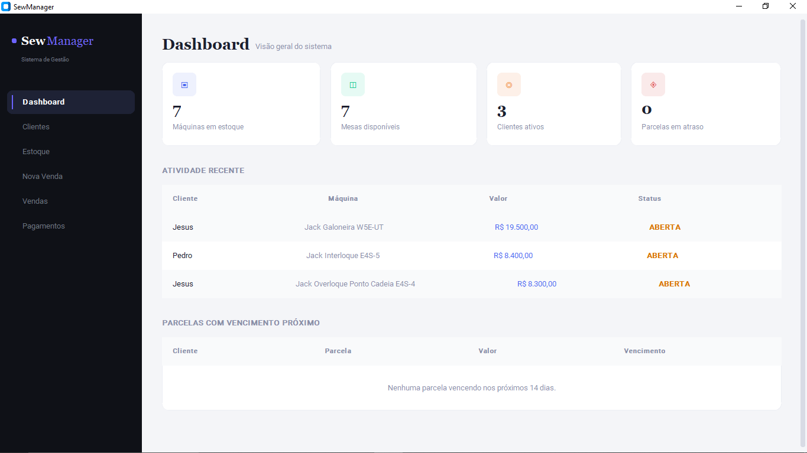
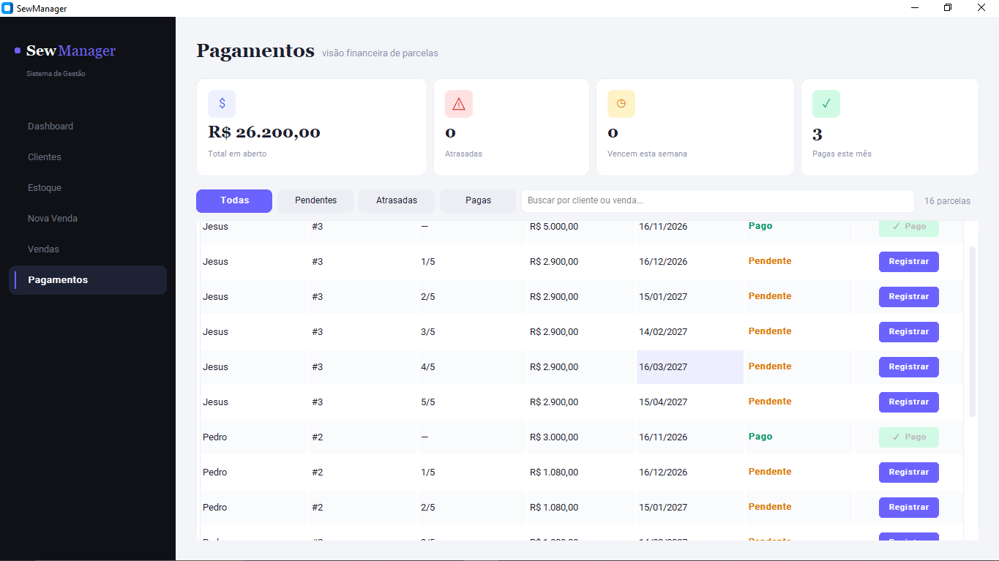
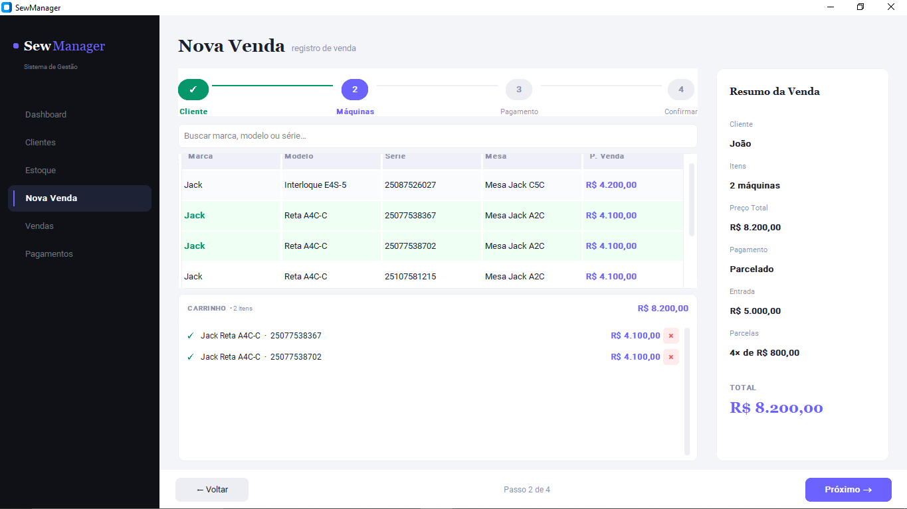

<div align="center">


# SewManager

**Sistema desktop para gestão de vendas, estoque, clientes e pagamentos de uma loja de máquinas de costura.**




</div>

---

## Sobre o projeto

O **SewManager** (executável: `SistemaCostura`) é uma aplicação desktop offline feita em Python para controlar o dia a dia de uma loja de máquinas de costura: cadastro de clientes, controle de estoque de máquinas e mesas, registro de vendas (à vista ou parceladas) e acompanhamento de parcelas e pagamentos.

Os dados ficam salvos localmente em um banco **SQLite** (`costura.db`), então não é necessário servidor nem conexão com a internet.

## Funcionalidades

- **Dashboard**: visão geral do negócio.
- **Clientes**: cadastro com nome, CPF/CNPJ, telefone e observações, além de resumo por cliente.
- **Estoque**: controle de máquinas (marca, modelo, nº de série, cor, preço de custo e preço de venda sugerido) e de mesas (modelo, material, cor), com status de disponibilidade.
- **Nova venda**: venda à vista ou parcelada, com valor de entrada e número de parcelas, incluindo várias máquinas por venda.
- **Vendas**: listagem, detalhes e saldo de cada venda.
- **Pagamentos**: registro de pagamentos, redistribuição automática do saldo entre as parcelas pendentes, controle de parcelas em aberto e atrasadas e histórico por venda.

## Telas

| Tela 1 | Tela 2 |
|:---:|:---:|
|  |  |

## Tecnologias

| Tecnologia | Uso |
|---|---|
| [Python 3.11+](https://www.python.org/) | Linguagem principal |
| [CustomTkinter](https://github.com/TomSchimansky/CustomTkinter) | Interface gráfica moderna |
| [CTkTable](https://github.com/Akascape/CTkTable) | Tabelas na interface |
| [SQLAlchemy](https://www.sqlalchemy.org/) | ORM e acesso ao banco |
| [SQLite](https://www.sqlite.org/) | Banco de dados local |
| [PyInstaller](https://pyinstaller.org/) | Geração do executável `.exe` |

## Estrutura do projeto

```
SewManager/
├── main.py                 # Ponto de entrada da aplicação
├── icon.ico                # Ícone do aplicativo
├── costura.db              # Banco SQLite
├── docs/                   # Imagens usadas no README
├── database/
│   ├── base.py             # Engine, sessão e inicialização do banco
│   ├── events.py           # Eventos do SQLAlchemy
│   └── models/             # Cliente, Maquina, Mesa, Venda, ItemVenda, Pagamento
├── services/               # Regras de negócio
│   ├── cliente_service.py
│   ├── estoque_service.py
│   ├── venda_service.py
│   └── pagamento_service.py
├── gui/
│   ├── main_window.py      # Janela principal e navegação
│   ├── views/              # Telas (dashboard, clientes, estoque, vendas...)
│   ├── components/         # Sidebar e modais reutilizáveis
│   ├── controllers/        # Controladores das telas
│   └── drafts/             # Rascunho de venda em andamento
└── SistemaCostura.spec     # Configuração do PyInstaller
```

## Como executar

### Pré-requisitos

- [Python 3.11 ou superior](https://www.python.org/downloads/)
- `pip`

### Instalação

```bash
# 1. Clone o repositório
git clone https://github.com/PomboN9878/SewManager.git
cd SewManager

# 2. (Opcional) Crie e ative um ambiente virtual
python -m venv venv
venv\Scripts\activate        # Windows
# source venv/bin/activate   # Linux / macOS

# 3. Instale as dependências
pip install customtkinter CTkTable sqlalchemy

# 4. Execute
python main.py
```

Na primeira execução, as tabelas do banco são criadas automaticamente.

## Gerando o executável

```bash
pip install pyinstaller
pyinstaller SistemaCostura.spec
```

O `.exe` será gerado na pasta `dist/`. O arquivo `costura.db` é criado/lido na mesma pasta do executável, então mantenha-os juntos.

## Backup dos dados

Todos os dados ficam no arquivo `costura.db`. Para fazer backup, basta copiar esse arquivo para um local seguro.

## Roadmap

- [ ] Relatórios exportáveis (PDF / Excel)
- [ ] Backup automático do banco
- [ ] Controle de usuários e permissões
- [ ] Tema escuro

## Licença

Este projeto está licenciado sob a licença **MIT**. Veja o arquivo [LICENSE](LICENSE) para mais detalhes.

## Autor

Feito por **[PomboN9878](https://github.com/PomboN9878)**.
